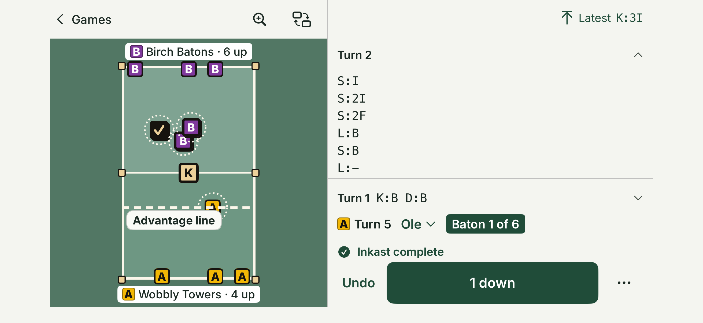

# Kubb: Pitchside

Pitchside is an iPhone scorekeeper for real games of kubb. Tap the kubbs that fell,
record a miss, or mark where a throw landed. Pinch to zoom into a drilled group
and tap the individual kubb that fell. Locally scored games remember each
standing placement for replay.

Start or resume scoring and the iPhone opens a full-screen landscape scorekeeper.
The pitch stays on the left. On the right, each entry shows the turn, player and
action in order. Tap the suggested player to change who threw. “Inkast complete”
marks the switch to batons and stays visible until you record the first baton.
The history shows a score line for each turn, such as `K:3I A K:2F D:B O:-`.
Names use the shortest prefix that distinguishes players across both teams.
Tap a turn to see its individual throws. With player tracking off, the line uses bare marks.

Games, setup, Roster, Stats, score sheets, the timeline and play by play use
portrait. Return to Games between turns and resume at the next throw.
In locally scored games, each inkast throw, rethrow and punishment placement has its
own replay step. A ring marks the kubb just placed when its spot was recorded.
Imported games show the inkast detail present in their notation file.

Open **More → Play by play** to review the latest throw while scoring, or use
**Play by play** on a score sheet to step through the pitch in either direction
or jump to a turn, including games imported from Throwing Wood.
Tap a turn on a locally scored sheet to correct a throw. Pitchside previews changes
to later turns. Undo and redo work for both throws and corrections, even after reopening a game.

Each game produces a plain-text Planet Kubb Notation file, a printable PDF score sheet
and player stats. Games are kept on the phone. Each finished game's file, with its
team and player names, is also in the Files app under iCloud Drive › Pitchside, in
the scorer's own iCloud (On My iPhone › Kubb: Pitchside when iCloud Drive is off).
The roster stays on the phone. Nothing is sent to us.



## Print a Throwing Wood game

1. Open **Score sheet** in Throwing Wood. Use **Save** on iPhone or **Download** on the web. The text file includes the recorded positions even when the screen hides them.
2. In Pitchside, choose **Games → Open file** and select that text file. Tap a turn to add a note. Pitchside keeps these notes with the imported game on this phone.
3. Tap **Score sheet PDF**, then use **Share → Print** or **Save to Files** in the preview.

The landscape Letter report pairs the two teams’ turns, compares team and player stats,
diagrams the recorded positions, and includes the original notation. On the diagrams,
each baton has its own panel. A shaded square shows a one-metre cell. A point or cross
shows a recorded coordinate. The record at the end retains exact coordinates and
multiple kubbs recorded at the same spot.

While scoring on grass, expand a turn in the history and choose **Add turn note**.
On a completed local game, tap the turn on the score sheet and choose **Add turn note**.
These notes go into the turn’s notation and follow the usual timeline undo and redo.


## Run it

Open `Pitchside.xcodeproj` in Xcode, select the **Pitchside** scheme and run on an
iPhone simulator with iOS 26 or later. The Kubb Engine and notation reader are
included in the checkout. Simulator builds require no developer account.

On a Mac with Xcode selected, run the package tests and check the pinned dependencies:

```sh
swift test --package-path PitchsideKit
scripts/vendor-engine.sh check
scripts/vendor-notation.sh check
```

For the archive comparison, install Node.js and place a checkout of
[pk-kubb-score](https://github.com/Planet-Kubb/pk-kubb-score) beside this repository.
To run the scoring journeys, select an installed iPhone simulator and use **Product → Test**.
The [agent guide](AGENTS.md#10-conventions-for-agents) covers storage, the scorer API
and the command-line build. Changes are welcome through pull requests.

## License

Pitchside uses the [MIT License](LICENSE). The bundled engine, Lua, musl, Planet Kubb
reader and fonts carry their respective notices in [PitchsideKit/Sources](PitchsideKit/Sources)
and [Pitchside/Fonts](Pitchside/Fonts).
