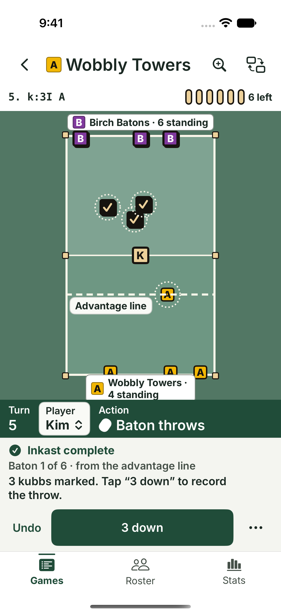

# Kubb: Pitchside

Pitchside is an iPhone scorekeeper for real games of kubb. Tap the kubbs that fell,
record a miss, or mark where a throw landed. Pinch to zoom into a drilled group
and tap the individual kubb that fell. Locally scored games remember each
standing placement for replay. Undo a throw in one tap or correct an
earlier turn in the timeline, even after the game finishes. Switch between Games,
Roster and Stats while scoring, then return to the throw you were marking.
In locally scored games, each inkast throw, rethrow and punishment placement has its
own replay step. A ring marks the kubb just placed when its spot was recorded.
Imported games show the inkast detail present in their notation file.

Open **More → Play by play** to review the latest throw while scoring, or use
**Play by play** on a score sheet to step through the pitch in either direction
or jump to a turn, including games imported from Throwing Wood.
Each game produces a plain-text Planet Kubb Notation file, a printable PDF score sheet
and player stats. Games and roster names stay on the phone until
the scorer chooses to share a file.



## Run it

Open `Pitchside.xcodeproj` in Xcode, select the **Pitchside** scheme and run on an
iPhone simulator with iOS 26 or later. The Kubb Engine and notation reader are
included in the checkout. Simulator builds require no developer account.

On a Mac with Xcode selected, run the package tests and check the pinned dependencies:

```sh
swift test --package-path PitchsideKit
scripts/vendor-engine.sh check
scripts/vendor-notation.sh check
```

For the archive comparison, install Node.js and place a checkout of
[pk-kubb-score](https://github.com/Planet-Kubb/pk-kubb-score) beside this repository.
To run the scoring journeys, select an installed iPhone simulator and use **Product → Test**.
The [agent guide](AGENTS.md#10-conventions-for-agents) covers storage, the scorer API
and the command-line build. Changes are welcome through pull requests.

## License

Pitchside uses the [MIT License](LICENSE). The bundled engine, Lua, musl, Planet Kubb
reader and fonts carry their respective notices in [PitchsideKit/Sources](PitchsideKit/Sources)
and [Pitchside/Fonts](Pitchside/Fonts).
